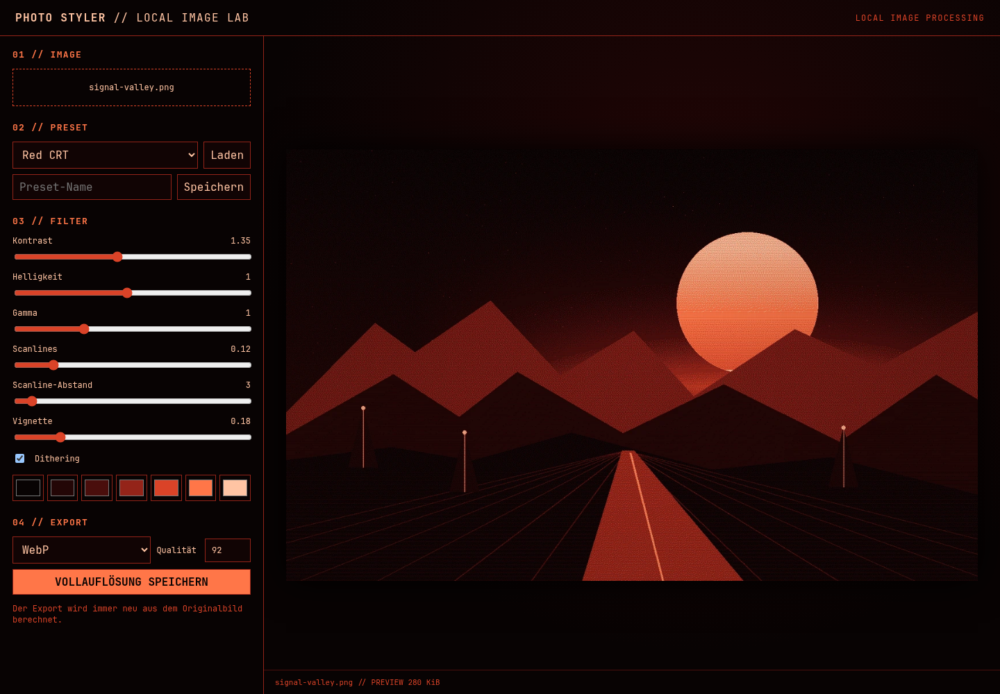
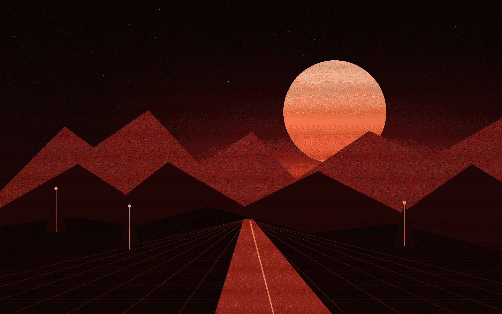

# Photo Styler

A local web app for palette-based image styling. Import a photo, tune its tones and CRT effects, and export at full resolution. A Python process on your machine renders the image and serves the browser interface.

## Try it

Use Linux with Python 3.12, 3.13, or 3.14 and [uv](https://docs.astral.sh/uv/getting-started/installation/) 0.13.9. From the project checkout:

```bash
uv sync --locked --no-dev --no-editable
uv run --no-sync photo-styler
```

Open [Photo Styler on loopback](http://127.0.0.1:8765). Import an image with **Bild auswählen**, select a preset and click **Laden**. Use **Vollauflösung speichern** to export. Stop the server with `Ctrl+C`.



| Capability | Release scope |
| --- | --- |
| Input | Single-frame JPEG, PNG and WebP. Optional HEIC/HEIF decoder. |
| Styling | Contrast, brightness, gamma, editable palette colors, Floyd–Steinberg dithering, scanlines and vignette |
| Presets | Red CRT, Dusk Cyan Artwork and locally saved presets |
| Output | Preview up to 1200 px on its longest side. Full-resolution PNG, JPEG or WebP export within input limits. |

## Before and after

The synthetic **Signal Valley** source is 1440 × 900. The export uses the bundled **Red CRT** preset with PNG selected as the output format. Select [the original](docs/media/signal-valley.png) in the app to reproduce it.

| Original | Red CRT |
| --- | --- |
|  |  |

## How it works

The browser serves as the file picker and editor. It sends the selected image and settings over local HTTP to FastAPI. Pillow decodes the image, applies its EXIF orientation, converts tone to palette colors, and renders the CRT effects. The browser receives an image preview or download. The Python pipeline in `photo_styler.filter_pipeline` also accepts image bytes or a Pillow image directly.

The server binds to `127.0.0.1` by default. It accepts images up to 32 MiB, 16 megapixels and 8192 pixels per side, and processes one render at a time. Uploads may spool to a temporary file during parsing. The server saves preset JSON on request. The browser retains the current filter settings in local storage and manages export downloads. Exported images omit source EXIF, XMP and embedded color profiles. See the [security and privacy details](SECURITY.md).

## Project information

- [Installation, optional HEIF, Docker and troubleshooting](docs/INSTALL.md)
- [Test and build commands](docs/QA.md)
- [Changelog](CHANGELOG.md) and [release notes draft](docs/RELEASE-NOTES.md)
- [MIT license](LICENSE) and [third-party notices and demo provenance](THIRD_PARTY_NOTICES.md)
